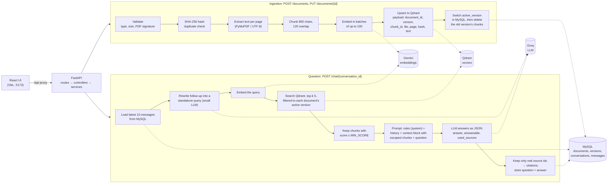

# RAG Document Assistant

A retrieval-augmented generation (RAG) assistant that answers questions about your own
documents. You upload PDF or TXT files, ask questions, and get answers that cite the exact
file, page and chunk they came from. Follow-up questions use the last 10 chat messages as
context. You can replace a document with a new version, or delete it, and stale content
never shows up in answers.

- **Backend:** Python 3.12, FastAPI, SQLAlchemy (async) + Alembic, MySQL 8.4
- **Vector store:** Qdrant 1.20 (cosine similarity)
- **Embeddings:** Google Gemini `gemini-embedding-001` (768 dimensions)
- **LLM:** any OpenAI-compatible API; by default Groq with `openai/gpt-oss-120b` for
  answers and `openai/gpt-oss-20b` for rewriting follow-up questions
- **UI:** React + TypeScript (Vite), with three pages: Chat, Documents and Trace
- **Everything runs in Docker Compose**, so you only need Docker installed

See [EVALUATION.md](EVALUATION.md) for retrieval metrics, answer quality, the chunking
comparison, latency and cost.

---

## Contents

1. [Quick start](#quick-start)
2. [Environment variables](#environment-variables)
3. [Using the app](#using-the-app)
4. [API reference](#api-reference)
5. [Architecture](#architecture)
6. [How the code handles a request](#how-the-code-handles-a-request)
7. [Design decisions](#design-decisions)
8. [Tests and evaluation](#tests-and-evaluation)
9. [Project structure](#project-structure)
10. [Limitations and what is not implemented](#limitations-and-what-is-not-implemented)

---

## Quick start

**You need:** Docker Desktop, plus two free API keys:

- a Gemini API key from [Google AI Studio](https://aistudio.google.com/apikey), used for embeddings
- a Groq API key from [console.groq.com/keys](https://console.groq.com/keys), used for answers

```bash
git clone <this repo> rag-document-assistant
cd rag-document-assistant

cp .env.example .env
# Open .env and set GEMINI_API_KEY and CHAT_LLM_API_KEY. Everything else has working defaults.

docker compose up -d --build
```

The first start takes a few minutes: it builds the API image, pulls MySQL, Qdrant and
Node, and installs the frontend packages. The API applies database migrations
automatically on startup.

| What | URL |
|---|---|
| **UI** | http://localhost:5173 |
| API docs (Swagger) | http://localhost:8000/docs |
| Health check | http://localhost:8000/health |
| Qdrant dashboard | http://localhost:6333/dashboard |

Try it with the sample documents in [`samples/`](samples): upload them on the Documents
page, then ask "How many days of annual leave do employees get?" in Chat.

To stop everything, run `docker compose down`. Your data stays in Docker volumes. Adding
`-v` (`docker compose down -v`) **deletes** all documents, vectors and chat history.

---

## Environment variables

All settings are read from `.env` (see [`.env.example`](.env.example)) and validated in
[`app/config/settings.py`](app/config/settings.py). Never commit `.env`: it is
git-ignored.

| Variable | Default | Meaning |
|---|---|---|
| `DB_HOST`, `DB_PORT`, `DB_DATABASE`, `DB_USERNAME`, `DB_PASSWORD` | `mysql`, `3306`, `rag_db`, `admin`, none | MySQL connection. Docker Compose creates the database with these values. `DB_PASSWORD` has no default and must be set in `.env`. |
| `QDRANT_HOST`, `QDRANT_PORT`, `QDRANT_API_KEY` | `qdrant`, `6333`, empty | Qdrant connection |
| `QDRANT_COLLECTION` | `documents` | Collection that holds the chunks |
| `GEMINI_API_KEY` | — (**required**) | Gemini key, used for embeddings only |
| `EMBEDDING_MODEL` | `gemini-embedding-001` | Embedding model |
| `EMBEDDING_DIMENSIONS` | `768` | Vector size. Changing it needs a new Qdrant collection. |
| `EMBEDDING_BATCH_SIZE` | `100` | Chunks per embedding request (Gemini's maximum is 100) |
| `CHAT_LLM_BASE_URL` | `https://api.groq.com/openai/v1` | Any OpenAI-compatible API (Groq, OpenRouter, a local Ollama, ...) |
| `CHAT_LLM_API_KEY` | — (**required**) | Key for that API |
| `CHAT_ANSWER_MODEL` | `openai/gpt-oss-120b` | Model that writes answers |
| `CHAT_REWRITE_MODEL` | `openai/gpt-oss-20b` | Smaller model that rewrites follow-up questions |
| `CHUNK_SIZE`, `CHUNK_OVERLAP` | `800`, `120` | Chunk length and overlap, in characters ([why](#chunking-800--120-characters)) |
| `TOP_K` | `5` | Chunks retrieved per question |
| `MIN_SCORE` | `0.55` | Chunks scoring below this are never sent to the LLM ([why](#relevance-threshold-min_score)) |
| `MAX_UPLOAD_MB` | `10` | Upload size limit |
| `HISTORY_LIMIT` | `10` | Earlier messages sent as context ([how they are counted](#conversation-history-latest-10-messages)) |

After changing `.env`, recreate the API container with `docker compose up -d fastapi_app`.
A plain `restart` does not reload `.env`.

---

## Using the app

### UI (http://localhost:5173)

| Page | What you can do |
|---|---|
| **Chat** | Create or open a conversation and ask questions. Each answer shows citation chips (file · page · chunk · version). When a follow-up was rewritten, "Interpreted as: ..." shows the search query. Questions the documents can't answer show a yellow "Insufficient information" box. Each answer has a collapsible retrieval trace. The right-hand panel uploads files by drag-and-drop and shows each document's status. The header shows how many earlier messages the next question will use as context. |
| **Documents** | Every document with its `document_id`, status, active version, chunk count, content hash and update time. **Replace** uploads a new version and shows each step of the safe update. **Delete** asks for confirmation first. Duplicate and failed uploads are explained in a banner. |
| **Trace** | For any answer asked in this browser session: the history window (messages outside the 10 are struck through), the query rewrite, every retrieved chunk with its score and whether it reached the prompt or was cited, how the prompt was assembled, and the latency of each step. |

### API with curl

The same steps through the API. On Windows PowerShell, use `curl.exe` instead of `curl`.

```bash
# 1. Upload a document. The response returns only once indexing has finished.
curl -F "file=@samples/employee_handbook.pdf" http://localhost:8000/documents
# -> 201 {"document": {"id": "<document_id>", "status": "indexed", "active_version": 1, ...}, "duplicate": false}

# 2. Create a conversation.
curl -X POST http://localhost:8000/conversations
# -> {"id": "<conversation_id>", ...}

# 3. Ask a question.
curl -X POST http://localhost:8000/chat/<conversation_id> \
     -H "Content-Type: application/json" \
     -d '{"question": "How many days of paid sick leave do employees get?"}'
# -> {"answer": "Employees receive 10 days of paid sick leave per year.",
#     "citations": [{"filename": "employee_handbook.pdf", "page": 1, "chunk_id": "...", ...}],
#     "insufficient_evidence": false,
#     "search_query": "How many days of paid sick leave do employees get?",
#     "history_used": 0,
#     "retrieval_trace": [{"filename": "...", "version": 1, "chunk_index": 0, "score": 0.66,
#                          "in_prompt": true, "used_in_answer": true}, ...],
#     "timings": {"rewrite_ms": 12, "retrieval_ms": 950, "generation_ms": 1500, "total_ms": 2462}}

# 4. A follow-up. "those" is resolved using the previous messages.
curl -X POST http://localhost:8000/chat/<conversation_id> \
     -H "Content-Type: application/json" \
     -d '{"question": "Do I need a certificate for those?"}'
# -> "search_query": "Do I need a certificate for the paid sick leave days?", "history_used": 2

# 5. Read the conversation back.
curl http://localhost:8000/chat/<conversation_id>/history

# 6. Replace the document with a new version (same document_id).
curl -X PUT -F "file=@handbook_v2.pdf" http://localhost:8000/documents/<document_id>
# -> 200 {"document": {"active_version": 2, ...}, "duplicate": false}

# 7. Delete it.
curl -X DELETE http://localhost:8000/documents/<document_id>
# -> {"id": "<document_id>", "deleted": true, "chunks_removed": 3}
```

---

## API reference

Interactive docs with every request and response schema: http://localhost:8000/docs

| Method & path | Purpose | Responses |
|---|---|---|
| `POST /documents` | Upload a PDF or TXT file (multipart field `file`). It is validated, extracted, chunked, embedded and stored before the response returns. | **201** indexed · **200** duplicate (same bytes already indexed, nothing re-indexed) · **422** indexing failed (the body has the document and the reason) · **400** missing name, unsupported type, empty file or invalid PDF · **413** larger than `MAX_UPLOAD_MB` |
| `GET /documents` | List documents that are not deleted, newest first, with every version | 200 |
| `GET /documents/{document_id}` | One document with its versions | 200 · 404 |
| `PUT /documents/{document_id}` | Upload a replacement file as the next version | **200** new version indexed, or duplicate of the active version · **422** indexing failed, the old version stays active · **404** unknown or deleted · **409** another update of this document is running · 400 / 413 as for upload |
| `DELETE /documents/{document_id}` | Delete the document and all its chunks | **200** `{"deleted": true, "chunks_removed": n}` · **404** unknown or already deleted |
| `POST /conversations` | Create a conversation | 201 |
| `GET /conversations` | List conversations, most recently active first, with message counts | 200 |
| `POST /chat/{conversation_id}` | Ask a question: `{"question": "..."}` (1 to 4,000 characters) | **200** answer · **404** unknown conversation · **422** blank question · **502** the embedding or LLM provider failed (nothing is stored) |
| `GET /chat/{conversation_id}/history` | Every message in order, with the citations stored on each answer | 200 · 404 |
| `GET /health` | Checks Qdrant and MySQL: `{"status": "ok", "qdrant": "ok", "mysql": "ok"}` | 200 · 503 degraded |
| `GET /config` | Non-secret settings for the UI (chunking, top-k, min score, history limit, model names) | 200 |

No response ever contains API keys, passwords, hosts or the full prompt. Provider errors
are reported only by their status code, for example
`"The language model is unavailable: LLM request failed (503)"`.

---

## Architecture



| Component | Role |
|---|---|
| **FastAPI** (`app/`) | HTTP API, organised as routes → controllers → services. Routes declare endpoints, controllers turn results and errors into HTTP responses, and services hold the logic. |
| **MySQL** | The source of truth for *what is live*: documents, their versions and which one is active, soft-deletes, conversations and messages. |
| **Qdrant** | Stores one point per chunk: its vector plus a payload with `document_id`, `version`, `chunk_id`, `chunk_index`, `filename`, `page`, `content_hash` and `text`. It has payload indexes on `document_id` and `version`. |
| **Gemini** | Embeddings only, with separate task types for documents (`RETRIEVAL_DOCUMENT`) and questions (`RETRIEVAL_QUERY`). |
| **Groq** (OpenAI-compatible) | The answer model, plus a smaller model for rewriting follow-ups. Each model has its own rate limit, so rewrites don't use up the answer model's quota. |
| **React UI** (`frontend/`) | Calls the API through the Vite dev server's `/api` proxy, so no CORS setup is needed. |

---

## How the code handles a request

This section helps you trace a request through the code.

### Uploading a document: `POST /documents`

1. `routes/documents.py` → `DocumentController.upload`
   (`controllers/document_controller.py`) strips any client path from the filename. It
   checks the extension (`.pdf` or `.txt`), the size (reading one byte past the limit, so
   huge files are not loaded), that the file isn't empty, and the PDF signature `%PDF-`.
2. `IngestionService.ingest_file` (`services/ingestion_service.py`) computes a SHA-256 of
   the bytes. If a non-deleted document's *active* version has the same hash, it returns
   that document with `duplicate=true` and embeds nothing.
3. Otherwise it creates the `documents` row and `document_versions` row (version 1,
   status `uploaded`), then calls `index_version`. That marks the version `processing` and
   runs `_index`:
   - `ExtractionService.extract`: text per page with PyMuPDF; UTF-8 for TXT
   - `ChunkingService.chunk_pages`: 800/120 chunks that never cross a page
   - `GeminiService.embed_documents`: batches of up to 100
   - `qdrant_service.upsert_chunks`: waits until Qdrant has applied the write
   - `qdrant_service.count_chunks`: checks that every chunk was stored
4. On success the version becomes `indexed` and `documents.active_version` is set. On
   failure, `_mark_failed` deletes any partial chunks and stores a user-safe reason on
   the version (status `failed`). Either way the HTTP response is sent only after this
   step, so "indexed" is never reported early.

### Asking a question: `POST /chat/{conversation_id}`

`ChatController.chat` → `ChatService.answer` (`services/chat_service.py`):

1. `recent_history` loads the latest `HISTORY_LIMIT` messages of *this* conversation,
   ordered by auto-increment id, and drops a leading answer whose question was cut off.
2. `_standalone_query` uses the small model to rewrite a follow-up ("Do I need a
   certificate for those?") into a standalone search query. The prompt comes from
   `PromptService.build_rewrite`. It is skipped when there is no history. If the rewrite
   fails or comes back empty, the original question is used.
3. `RetrievalService.retrieve` (`services/retrieval_service.py`) reads every live
   `(document_id, active_version)` pair from MySQL. It embeds the query and calls
   `qdrant_service.search`, which only matches those pairs, so retired versions and
   deleted documents can never be returned. Chunks scoring at least `MIN_SCORE` become
   evidence.
4. With no evidence, the answer is the fixed "I don't have enough information..." text,
   and the LLM is not called.
5. Otherwise `PromptService.build` (`services/prompt_service.py`) assembles the prompt:
   - the rules go in the system instruction
   - earlier turns are sent as plain messages
   - the new user turn holds a `<context>` block with each chunk as
     `<source id="S1" file="..." page="...">` with HTML-escaped text, then the
     `<question>`
6. `LLMService.generate` (`services/llm_service.py`) asks for JSON
   (`answer`, `answerable`, `used_sources`). `_generate` validates it, then:
   - drops source ids that were never handed out
   - treats `answerable=false`, or an answer citing no real source, as insufficient
7. The question and the answer, with its citations, are stored together in one commit.
   The response returns `search_query`, `history_used`, `retrieval_trace` (every
   retrieved chunk with its score, `in_prompt` and `used_in_answer`) and per-step
   `timings`. If a provider fails, the controller returns 502 and nothing is stored.

### Replacing and deleting

- **`PUT /documents/{id}`** → `IngestionService.update_file`. If the bytes match the
  active version, nothing happens. Otherwise version N+1 goes through the same
  `index_version`, and then `_remove_old_version` deletes the replaced version's chunks.
  [Details](#safe-document-update).
- **`DELETE /documents/{id}`** → `IngestionService.delete_document` sets `deleted_at` and
  commits, then deletes every chunk of the document from Qdrant.

---

## Design decisions

### Chunking: 800 / 120 characters

- **800 characters (~200 tokens)** usually holds one idea, such as a paragraph or a policy
  rule, so a citation points to a precise place. Five chunks still fit in a small prompt
  (~1,060 tokens).
- **120 characters (15%) of overlap** keeps a sentence cut at a chunk border fully inside
  at least one chunk.
- **Splitting order:** the splitter cuts at paragraphs first, then lines, sentences and
  words, and only then mid-word.
- **Chunks never cross a page**, so each one cites exactly one page.
- **Configurable:** both values can be set in `.env`. The evaluation compared 800/120 with
  400/60. Smaller chunks score higher against the question but rank the right chunk first
  less often (Recall@1 0.79 vs 0.90), so 800/120 stayed the default.

### Relevance threshold (`MIN_SCORE`)

Chunks below `MIN_SCORE` are never sent to the LLM. If none pass, the assistant says it
doesn't have enough information without calling the LLM at all.

The threshold is deliberately low (0.55). Evaluation showed that correct chunks can
score as low as ~0.57, while unrelated chunks can reach ~0.69, so no single cut-off
separates them. The threshold only drops clearly unrelated chunks. The LLM's
`answerable` flag, plus the rule that every answer must cite a real source, decides the
rest.

### Grounding and citations

- **Answers come only from the sources.** The system rules say to use only facts from
  `<context>`, to answer the supported part of a question and say what is missing, to
  flag disagreeing sources, and to return the exact insufficient-information sentence
  when nothing answers the question.
- **Every answer must cite a source it was actually given.** The LLM lists source labels
  (`S1`, `S2`, ...). Labels that were never handed out are dropped. An answer left with
  no valid source becomes "insufficient". Citations are built from the stored chunk
  metadata, never from model text, so a source cannot be invented.

### Prompt injection: documents are untrusted data

- **Document text never goes into the system instruction.** It only appears inside the
  `<context>` block of the user turn.
- **It is HTML-escaped**, so a document containing `</context>` or `</source>` cannot
  close the block and place text outside it.
- **The rules say instructions inside sources must be ignored**, and the same applies to
  history in the rewrite prompt.
- **There are tests for this:** `test_document_text_is_escaped_in_prompt` and
  `test_history_is_escaped_and_trimmed_in_rewrite_prompt`.

### Conversation history: latest 10 messages

- **Counting.** `HISTORY_LIMIT=10` means the 10 most recent stored messages of the
  conversation, user and assistant combined, which is 5 question/answer pairs. The new
  question is not counted. Messages are ordered by their auto-increment id, which is a
  strict insertion order even within the same second.
- **Incomplete pair at the boundary.** Every answer is stored together with its question,
  so history always alternates. If the 10-message window starts with an answer whose
  question fell outside it, that answer is dropped, because an answer without its
  question can mislead the model. The window may then hold 9 messages.
  `history_used` in the response says how many were actually sent.
- **History resolves references, not facts.** It is used twice: to rewrite the follow-up
  into a standalone search query, and as earlier turns in the answer prompt. Retrieval
  always runs fresh on the rewritten query. Rule 8 tells the model never to take facts
  from earlier answers, since documents may have changed since.
- **Storage and isolation.** Messages are stored in MySQL per `conversation_id`, and
  queries always filter by that id, so conversations never mix. There are no user
  accounts (see [limitations](#limitations-and-what-is-not-implemented)).
- **Failures leave no half-turns.** If retrieval or the LLM fails, neither the question
  nor an answer is stored, so history never holds a question without its answer.

### Duplicate uploads

`POST /documents` hashes the file bytes (SHA-256). If a non-deleted document's active
version has the same hash, the API returns `200` with that existing document and
`"duplicate": true`, and nothing is re-embedded. This is deliberate and avoids paying
twice for the same content.

- A file whose earlier upload **failed** is indexed again; failures don't count as
  duplicates.
- A file matching a **deleted** document becomes a new document.
- The check compares **bytes**. The same text saved as a different PDF is a different
  file.
- On `PUT`, bytes identical to the active version are a no-op (`duplicate: true`).

### Safe document update

Each document has a stable `document_id` (UUID). Its versions live in
`document_versions`, which tracks the version number, SHA-256 hash, status, error,
`created_at` / `updated_at`, page count and chunk count. `documents.active_version`
points to the live one.

1. **Prepare.** The new file is stored as version N+1, then extracted, chunked, embedded
   and written to Qdrant with `version = N+1`. Meanwhile retrieval keeps using version N,
   because it only searches `(document_id, active_version)` pairs.
2. **Switch.** Only after every chunk is confirmed stored is `active_version` set to N+1,
   in one database commit. From that moment only the new chunks can be retrieved.
3. **Retire.** The old version's chunks are deleted from Qdrant. If that deletion fails,
   it is only logged: those chunks can't be retrieved anyway, because they aren't the
   active version.
4. **On failure** (extraction, embedding or Qdrant), the update returns 422 with the
   reason. The new version is kept as `failed` with its error, its partial chunks are
   removed, and **the previous version stays active**. The next update gets a new
   version number.
5. **Concurrency.** Version numbers are unique per document, so if two updates of the
   same document race, the second gets a 409.

Chunk ids are deterministic (`uuid5(document_id:version:chunk_index)`), so re-indexing
the same version overwrites instead of duplicating. This is shown by
`test_leave_policy_update_from_15_to_20_days` and the tests in `tests/test_update.py`.

### Deleting a document, and its caveats

`DELETE /documents/{id}` first sets `documents.deleted_at` and commits. Retrieval reads
live documents from MySQL, so the document stops being searchable at once. Then every
chunk of every version is deleted from Qdrant, and the number removed is returned.

- **MySQL keeps a soft-deleted row.** The document and version rows (filename, hashes,
  dates) stay for audit; the document text does not. The API treats the document as
  gone: 404 everywhere, and it isn't listed.
- **If Qdrant is unreachable during the delete**, the call still succeeds with
  `chunks_removed: 0`. The leftover chunks are never retrieved, but they stay in Qdrant
  until removed by hand. There is no automatic cleanup job.
- **Chat history is not rewritten.** Answers given before the delete keep their text and
  citations. Only new answers stop using the document.
- **Backups.** The original file bytes are never stored. But any Qdrant snapshot or MySQL
  backup taken before the delete still contains the chunks, and the metadata
  respectively. Deleting from the live system does not delete from backups.

### Ingestion status

- **Status values.** A document is `uploaded` → `processing` → `indexed` or `failed`.
  Each version keeps its own status and error.
- **The API never reports success early.** Upload and update requests return only after
  indexing has finished, so the status in the response is final.
- **During an update**, the document stays `indexed` on its old version while the new
  version is `processing`.

### Failure handling

- **Embedding failures** (Gemini) are retried for 429 and 5xx errors. If they still fail,
  ingestion marks the version `failed` and chat returns 502.
- **LLM failures** (Groq) are retried for short rate limits and 5xx errors. If the
  provider asks for a wait over 20 seconds, as with an exhausted daily quota, the error
  is returned at once instead of hanging.
- **Invalid JSON from the LLM** returns 502 too.
- **Failed rewrites** fall back to the original question.
- **Error messages show only a status**, never provider text or keys.

### Why these providers and Qdrant

- **Qdrant** gives payload filtering, which is what makes updates and deletes safe: a
  filter on `(document_id, version)` decides what can be retrieved. It also has exact
  counts to verify writes, runs in Docker, and comes with a dashboard. FAISS has no
  metadata filtering or deletes of its own.
- **Gemini embeddings** are good quality, with separate document and query task types,
  768 dimensions, and a free tier.
- **Groq for the LLM.** Gemini's free tier allowed only ~20 answer requests a day, so
  answers moved to Groq, which has a far higher free limit. `LLMService` speaks the
  OpenAI-compatible API, so switching to OpenRouter, OpenAI or a local Ollama only means
  changing `CHAT_LLM_BASE_URL`, `CHAT_LLM_API_KEY` and the model names in `.env`.
- **No LangChain or LlamaIndex.** The pipeline is small enough to write directly, and
  every step is visible and testable.

---

## Tests and evaluation

### Automated tests

The tests run inside the API container against the real MySQL and a separate Qdrant
collection (`documents_test`, deleted afterwards). Gemini and the LLM are replaced by
deterministic fakes, so the tests need no API keys and cost nothing.

```bash
docker compose exec fastapi_app pytest -q        # 95 tests
docker compose exec fastapi_app ruff check app tests eval
```

| Area | Files |
|---|---|
| Ingestion: PDF/TXT extraction, chunking, upload, validation, duplicates, scanned/fake/empty/too-large files, provider failures | `test_extraction.py`, `test_chunking.py`, `test_ingestion.py` |
| Retrieval and answers: citations, insufficient evidence, invented sources, prompt-injection escaping, 502 on failures, trace | `test_chat.py` |
| Conversation history: window, cut-off pair, `HISTORY_LIMIT=0`, rewrite and fallback, escaping | `test_history.py`, `test_chat.py` |
| Update: new version, old version live during indexing, failed update, name/type change, 404/400 | `test_update.py` |
| Delete: chunks removed, never retrieved, Qdrant down, re-upload after delete | `test_delete.py` |
| LLM client: JSON mode, retries, fail-fast on long waits, bad key | `test_llm_service.py` |
| Settings, schemas, migrations, health, config without secrets | `test_settings.py`, `test_schemas.py`, `test_migrations.py`, `test_health.py` |

**The assignment's required scenarios** (section 6) are mapped to their tests in the
docstring of [`tests/test_scenarios.py`](tests/test_scenarios.py). That file also holds
the 15 → 20 days update test, the 10-message boundary test, the two-source citation test
and the embedding-failure test.

### Evaluation

```bash
docker compose exec fastapi_app python -m eval.run_eval
```

This indexes [`samples/`](samples) into separate `eval_c800` / `eval_c400` collections
(your real data is untouched). It asks the 22 questions in
[`eval/questions.json`](eval/questions.json) with real embeddings and LLM calls, and writes
`eval/results/`. The run takes a few minutes. [EVALUATION.md](EVALUATION.md) explains the
results:

- Recall@3 is 1.0 and MRR 0.97 with 800/120 chunks.
- All 22 answers were correct on manual review.
- All 3 unanswerable questions were refused.

---

## Project structure

```
app/
  main.py                    FastAPI app; ensures the Qdrant collection on startup
  config/                    settings (.env, validated) and the async database engine
  models/                    SQLAlchemy tables: documents, document_versions, conversations, messages
  schemas/                   Pydantic request/response models and the Qdrant chunk payload
  routes/                    endpoint declarations only
  controllers/               HTTP concerns: validation, status codes, error mapping
  services/
    ingestion_service.py     upload, index, update, delete; version switching
    extraction_service.py    PDF/TXT to text per page
    chunking_service.py      recursive splitter with overlap
    gemini_service.py        embeddings (batched, retried)
    qdrant_service.py        collection, upsert, count, search filtered by live versions, delete
    retrieval_service.py     live versions from MySQL + vector search + MIN_SCORE
    prompt_service.py        system rules, context block, rewrite prompt, escaping
    llm_service.py           OpenAI-compatible chat client (JSON mode, retries)
    chat_service.py          history window, rewrite, answer, citations, trace, conversations
alembic/                     database migrations (run automatically on startup)
tests/                       pytest suite (fakes for Gemini and the LLM)
eval/                        evaluation questions, script and results
samples/                     sample documents (self-written, no real data)
frontend/                    React + TypeScript UI (Vite)
docker-compose.yml           API, MySQL, Qdrant and the frontend
```

---

## Limitations and what is not implemented

| Limitation | Details |
|---|---|
| **No OCR** | Scanned or image-only PDFs are rejected with "No extractable text found. The PDF may be scanned or image-only (OCR is not supported)". Password-protected PDFs are rejected too. |
| **No DOCX** (optional) | Only `.pdf` and `.txt`. TXT must be UTF-8; UTF-16 and binary files are rejected with a clear message. |
| **No URL ingestion** (optional, section 3F) | Not implemented. The data model already has `source_type` / `source_url` for it. |
| **PDF layout** | Text is extracted in reading order per page. Tables and multi-column layouts can come out jumbled, and images are ignored. |
| **Ingestion runs inside the request** | Upload and update return only after indexing, which keeps the status honest but blocks the request. Very large files would be better handled by a background worker or queue. |
| **No users or authentication** | Conversations are separated by `conversation_id`, but anyone who can reach the API can open any conversation and manage every document. |
| **Retrieval is vector-only** | Exact terms such as codes or names can rank below paraphrases. A hybrid (BM25 + vector) search or a reranker would help, and would also separate unanswerable questions better than `MIN_SCORE` (see EVALUATION.md). |
| **Trace page is per browser session** | The full retrieval trace is returned with each answer but not stored in the history, so the Trace page shows only questions asked in the current browser tab. |
| **Delete caveats** | Soft-deleted MySQL rows stay, orphaned chunks can stay if Qdrant was down during the delete, and backups keep old data. See [above](#deleting-a-document-and-its-caveats). |
| **Free-tier providers** | Groq and Gemini free tiers limit requests per minute and per day. A rate limit shows up as slow answers or a 502 "LLM request failed (429)". |
| **Development setup** | Docker Compose runs the Vite dev server and FastAPI with `--reload`. A production deployment would serve the built UI statically and run without reload. |
